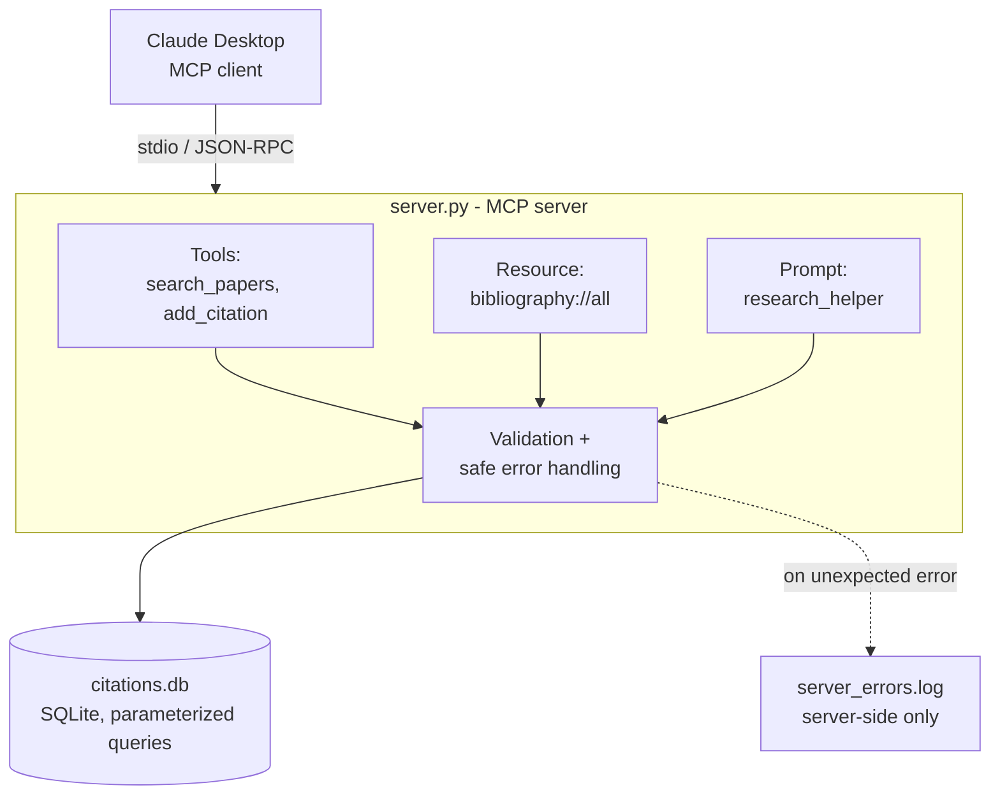

# Architecture

**Flow summary**

1. Claude Desktop connects to `server.py` over stdio using the MCP protocol.
2. Tool calls, resource reads, and the prompt template all pass through one shared validation and error-handling layer before touching data.
3. Validated input reaches `citations.db` through parameterized SQL queries only.
4. Any unexpected failure is logged privately to `server_errors.log` and never shown to the user in detail.